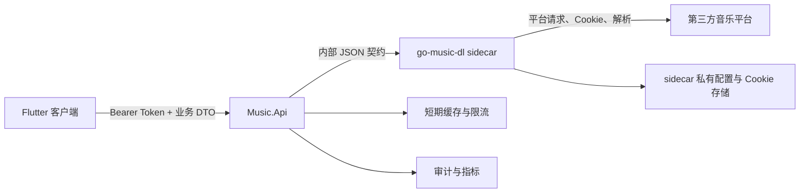
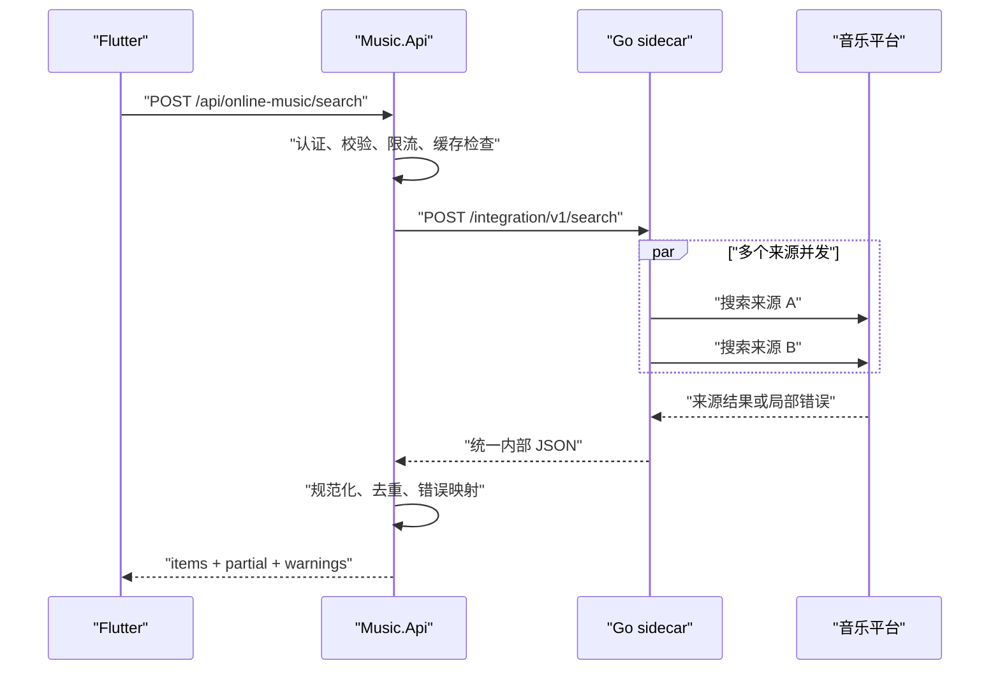
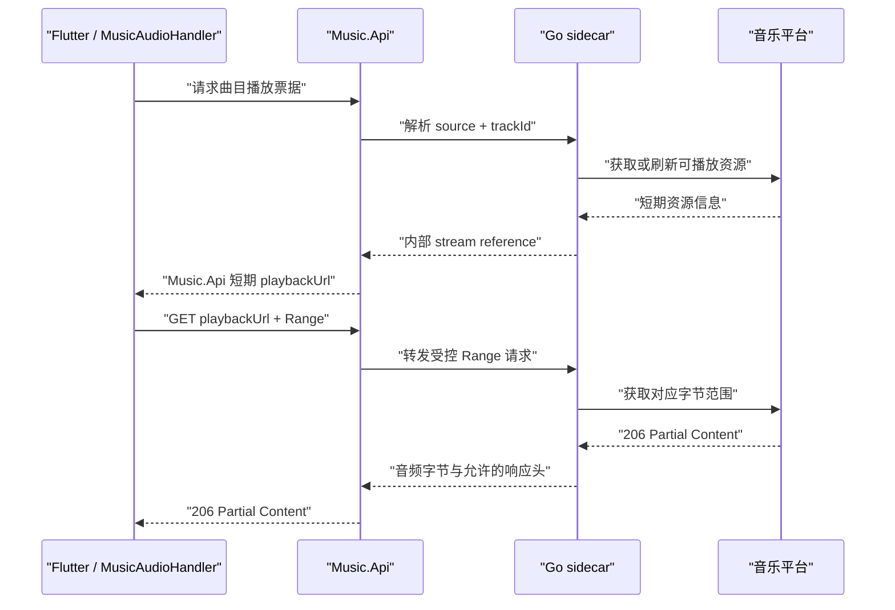

# go-music-dl 在线搜索接入方案

> 状态：搜索、在线播放、歌词/封面缓存、运维加固和下载入库已实现；Windows/Linux/Android 使用全局播放器，Web 受认证请求头能力限制暂不开放播放与下载
> 最后更新：2026-09-06
> 适用范围：Flutter 客户端、`backend/Music.Api`、独立运行的 `go-music-dl` sidecar

## 1. 结论

采用以下接入拓扑：

```text
Flutter 客户端
      ↓ 仅调用稳定的业务 API
Music.Api（认证、契约、限流、缓存、审计）
      ↓ 仅在内网调用
go-music-dl sidecar（音乐源适配、解析、代理流）
      ↓
第三方音乐平台
```

核心原则：

- Flutter 不直接调用 `go-music-dl`。
- 不把 Go 代码嵌入 ASP.NET，也不在生产环境用 ASP.NET 启停 CLI 子进程。
- `Music.Api` 是客户端唯一可见的后端和稳定 BFF（Backend for Frontend）边界。
- `go-music-dl` 作为独立进程或容器运行，只向回环地址或容器私有网络开放。
- Flutter、数据库和日志都不保存第三方平台的原始播放 URL、Cookie 或签名参数。

该方案把变化频繁的音乐源逻辑隔离在 Go sidecar 中，同时让现有账号认证、错误格式、限流和可观测性继续由 `Music.Api` 统一管理。

## 2. 背景与上游现状

SimulGroove Music 的在线搜索页已通过 `OnlineMusicGateway`/`AuthRepository` 接入 `Music.Api`，真实账号与后端请求继续沿用既有认证边界。页面不自行管理另一个服务的 URL、Cookie 或 HTTP 客户端。

仓库内的 `go-music-dl` clone 以集成提交 `11bfd8b` 固定本地改动，该提交基于上游 `c5a30343f12fafbad83245eee2119768a77be575`，并包含跨音乐源搜索、播放、歌词、封面和下载相关能力。它当前的 Web 实现有以下可复用点和限制：

- Web 服务默认路由前缀是 `/music`，并提供健康检查。
- `/music/download?stream=1` 已包含流式代理及 HTTP Range 处理，可作为播放代理实现的参考或底层能力。
- `/music/lyric`、`/music/cover_proxy` 等路由可提供歌词和封面数据。
- `/music/inspect` 会返回上游原始 URL；该字段不应直接透传给 Flutter。
- `/music/search` 当前渲染 HTML，而不是面向服务集成的稳定 JSON 契约，因此不能让 `Music.Api` 依赖 HTML 结构。
- 现有 CORS 和部分代理路由面向其自带 Web UI，不应原样暴露到公网。

以上行为可在上游的 [Web 服务注册](https://github.com/guohuiyuan/go-music-dl/blob/main/internal/web/server.go) 和 [音乐路由实现](https://github.com/guohuiyuan/go-music-dl/blob/main/internal/web/music.go) 中核对。接入时应固定经过验证的 tag、commit 或镜像 digest，并通过契约测试防止上游升级造成静默破坏。

## 3. 目标与非目标

### 3.1 第一阶段目标

- Flutter 能按关键字搜索一个或多个已允许的音乐源。
- 搜索结果使用统一模型展示来源、歌曲、歌手、专辑、时长和可播放状态。
- 单个音乐源失败时可返回其他来源的结果，并明确显示“部分结果不可用”。
- 播放时仍使用全局唯一的 `MusicAudioHandler`，支持暂停、继续、切歌和拖动进度。
- Flutter 只接触 `Music.Api` 生成的短期播放地址，不接触第三方 Cookie 或原始 URL。
- Windows、Linux、Android 和 Web 使用同一套公开 API 契约；Web 只启用其可安全承载的搜索与账号能力。

### 3.2 第一阶段非目标（历史边界）

- 不实现音乐文件永久下载或离线缓存。
- 不把第三方音乐平台 Cookie 管理放进 Flutter。
- 不同步第三方歌单、专辑或用户账号。
- 不把在线搜索结果立即写入本地 `Tracks` 表；若未来需要收藏或入歌单，应先设计稳定的在线曲目引用模型。
- 不承诺所有来源、所有地区或所有曲目都可播放。
- 不将该能力直接作为公开、多租户的音乐分发服务上线。

这些限制描述的是“只接搜索”的阶段 1。后续阶段已经加入受控下载和在线歌曲歌单占位记录，但 Cookie、第三方 URL、不可靠来源和公网分发等安全边界仍保持不变。

## 4. 架构与职责边界



### 4.1 Flutter

负责：

- 搜索输入、去抖、取消或忽略过期请求。
- `idle`、`loading`、`data`、`empty`、`partial`、`error` 状态展示。
- 展示来源与可播放状态。
- 将在线曲目转换为播放器可识别的队列项。
- 通过现有认证与 Gateway 边界请求 `Music.Api`。

不负责：

- 音乐源签名、Cookie、解密或 URL 刷新。
- 直接调用 sidecar。
- 创建第二个 `AudioPlayer`。
- 保存可长期复用的第三方播放 URL。

### 4.2 Music.Api

负责：

- Flutter 账号认证和账号级访问控制。
- 对外提供稳定、版本化的在线音乐 API。
- 参数校验、来源白名单、限流、超时、缓存和熔断。
- 将 sidecar 数据映射成项目自己的 DTO。
- 生成短期、不可猜测、可绑定账号的播放票据。
- 转发 Range 请求并过滤响应头。
- 将 sidecar 错误映射成稳定错误码。
- 记录不包含敏感数据的指标和审计事件。

不负责：

- 复制每个音乐平台的签名、解析和 Cookie 规则。
- 依赖 `go-music-dl` 的 HTML 页面结构。
- 向客户端泄露 sidecar 地址或第三方原始 URL。

### 4.3 go-music-dl sidecar

负责：

- 音乐源搜索、详情解析、播放地址解析、歌词和封面获取。
- 平台 Cookie、签名、必要的解密和来源切换。
- 与第三方源交互时的 Range 或流代理细节。
- 提供专用于服务集成的内部 JSON API。

不负责：

- Flutter 用户账号、JWT、歌单或喜欢数据。
- 对公网提供业务 API。
- 决定产品级权限、限流额度或持久化策略。

## 5. 为什么选择独立 sidecar

| 方案 | 结论 | 原因 |
| --- | --- | --- |
| Flutter 直连 go-music-dl | 不采用 | 暴露内部服务和源协议；认证、CORS、Cookie、平台差异都会进入客户端 |
| 把 Go 源码移植或嵌入 ASP.NET | 不采用 | 语言与依赖耦合高，上游升级难，容易形成长期维护分叉 |
| ASP.NET 每次调用 CLI 子进程 | 不采用 | 启动成本高，超时和并发难控制，输出契约不稳定，生产运维困难 |
| 独立 Go sidecar + Music.Api BFF | 采用 | 进程隔离、可独立升级和重启，同时保持单一公开 API 与稳定 DTO |

生产环境由容器编排器或操作系统服务管理器监督 sidecar。开发环境可由脚本或 Compose 同时启动两个服务，但 `Music.Api` 不承担 sidecar 的生产进程生命周期。

## 6. sidecar 内部 API

不能把现有 HTML 搜索页当成服务契约。建议在固定版本的 `go-music-dl` fork 中增加很薄的 JSON 适配层，直接复用其搜索和解析能力。

建议内部路由：

```text
GET  /integration/v1/health
POST /integration/v1/search
POST /integration/v1/tracks/{source}/{trackId}/resolve
GET  /integration/v1/tracks/{source}/{trackId}/lyrics
GET  /integration/v1/tracks/{source}/{trackId}/cover
GET  /integration/v1/streams/{streamToken}
```

### 6.1 状态码契约（修改前必读）

`Music.Api` 的进程内熔断器**直接依赖**下面的划分，改动 sidecar 的状态码会改变熔断行为：

- **4xx**：稳定的业务结果。"这首曲目没有封面/歌词/可播放音源"这类结论在重试后不会改变。`Music.Api` 不会把它计入瞬时故障熔断。
- **5xx**：值得重试的故障，只用于网络错误、超时和上游 5xx。

| 场景 | 状态码 | `code` |
| --- | --- | --- |
| 来源不支持或参数非法 | `400` | `unsupported_track` |
| 曲目拿不到可播放音源（无源 / VIP / 已下架） | `422` | `resolve_unavailable` |
| 解析超时等瞬时故障 | `502` | `resolve_upstream_error` |
| 曲目没有封面 / 歌词 | `404` | `asset_not_found` |
| 封面 / 歌词确实不可用（上游 4xx、地址非法、内容不是图片） | `422` | `asset_unavailable` |
| 封面 / 歌词拉取的网络错误或上游 5xx | `502` | `asset_upstream_error` |
| 资源超过大小限制 | `413` | `asset_too_large` |
| 下载不可用 / 下载瞬时故障 | `422` / `502` | `download_unavailable` / `download_upstream_error` |
| 流票据不存在 / 过期 / Range 非法 | `404` / `410` / `416` | `stream_not_found` / `stream_expired` / `invalid_range` |
| 上游音频地址失效 / 连接上游的瞬时故障 | `422` / `502` | `stream_unavailable` / `stream_upstream_error` |

历史上 `resolve_failed`、`asset_unavailable`、`upstream_stream_failed` 全部使用 `502`，导致一次批量封面拉取失败就把共享熔断器打开，紧接着的**搜索**返回"在线音乐服务暂时不可用"。这是必须避免的回归。

封面内容类型的判定以字节嗅探为准、响应头只作兜底：部分 CDN（例如 netease 的 `p1.music.126.net`）返回非标准的 `image/jpg`，直接按白名单校验响应头会把每张 netease 封面都判成失败。

内部搜索请求示例：

```json
{
  "query": "夜曲",
  "sources": ["source-a", "source-b"],
  "limit": 20,
  "cursor": null
}
```

内部搜索响应示例：

```json
{
  "items": [
    {
      "source": "source-a",
      "trackId": "123456",
      "title": "歌曲名",
      "artists": ["歌手名"],
      "album": "专辑名",
      "durationMs": 238000,
      "artworkRef": "opaque-cover-reference",
      "playable": true
    }
  ],
  "warnings": [
    {
      "source": "source-b",
      "code": "upstream_timeout"
    }
  ],
  "nextCursor": "opaque-search-page-cursor"
}
```

内部 DTO 也不应包含可被客户端长期复用的上游 URL。若底层解析必须产生 URL，应只留在 sidecar 内存或短期票据中。

`cursor` 是 sidecar 生成的短期结果页游标：首屏请求省略或传空，响应带回 `nextCursor` 后原样传回即可取下一页，`nextCursor` 为空表示没有更多。上游各来源的搜索接口都不支持翻页，因此 sidecar 首次请求就把所有来源的结果聚合成一个池子并缓存（默认 10 分钟），游标只在这个池子里切片，不会为下一页重新请求上游。缓存过期或游标与 `query`/`sources` 不匹配时返回 `200` 空页，而不是 `400`，避免客户端反复重试同一个失效游标；只有格式非法的游标才返回 `400 invalid_request`。

clone 中已新增独立目录，避免把集成逻辑散落在原有页面处理器中：

```text
internal/integrationapi/
  routes.go
  dto.go
  mapper.go
  search.go
  server.go
```

## 7. Music.Api 公开 API

公开路径以项目最终路由约定为准，建议使用以下资源结构：

```text
GET  /api/online-music/sources
POST /api/online-music/search
POST /api/online-music/tracks/{source}/{trackId}/playback
GET  /api/online-music/playback/{ticket}
GET  /api/online-music/tracks/{source}/{trackId}/lyrics
GET  /api/online-music/tracks/{source}/{trackId}/cover
```

除健康检查外，公开接口统一使用 SimulGroove Music 的 Bearer Token。客户端不能传入任意 sidecar URL、第三方 URL、请求头或 Cookie。

### 7.1 公开搜索契约

请求：

```json
{
  "query": "夜曲",
  "sources": ["source-a", "source-b"],
  "limit": 20,
  "cursor": null
}
```

响应：

```json
{
  "items": [
    {
      "provider": "source-a",
      "trackId": "123456",
      "title": "歌曲名",
      "artists": ["歌手名"],
      "album": "专辑名",
      "durationMs": 238000,
      "artworkUrl": "/api/online-music/tracks/source-a/123456/cover",
      "playable": true,
      "capabilities": ["playback", "lyrics", "artwork"]
    }
  ],
  "partial": true,
  "warnings": [
    {
      "provider": "source-b",
      "code": "online_music_source_unavailable",
      "message": "该来源暂时不可用"
    }
  ],
  "nextCursor": null
}
```

公开结果的稳定身份是 `provider + trackId`。标题、歌手和专辑不能作为唯一键。

### 7.2 播放票据

Flutter 先请求短期播放票据：

```json
{
  "playbackUrl": "/api/online-music/playback/opaque-short-lived-ticket",
  "expiresAt": "2026-08-08T12:02:00Z",
  "mimeType": "audio/mpeg"
}
```

票据建议具备以下属性：

- 有效期 1 至 5 分钟。
- 绑定账号、来源和曲目，必要时绑定用途。
- 可签名但不可包含明文 Cookie 或原始 URL。
- 到期返回稳定的 410 或重新解析提示。
- 播放流开始后是否允许票据持续使用，应由明确的服务端策略决定。

Music.Api 的播放端点必须转发客户端的 `Range` 请求，并只回传必要的 `Content-Type`、`Content-Length`、`Accept-Ranges`、`Content-Range`、`ETag` 等安全响应头。不要把整首歌读入内存后再返回。

## 8. 核心调用流程

### 8.1 搜索



搜索框建议约 350 毫秒去抖。新请求发出后，旧请求即使晚返回也不得覆盖新关键字的结果。

### 8.2 播放



如果某个来源必须整文件解密，sidecar 可以在受控临时目录中处理，但必须设置大小、并发、超时和清理策略；不能把这种降级扩散到 Flutter 或让 Music.Api 无界缓存。

## 9. 错误语义与降级

| 场景 | HTTP | 稳定错误码/行为 |
| --- | ---: | --- |
| 参数非法、关键字过长、来源不允许 | 400 | `online_music_invalid_request` |
| 未登录或会话失效 | 401 | 沿用现有认证刷新与单次重试 |
| 曲目不存在 | 404 | `online_music_track_unavailable` |
| 播放票据过期 | 410 | `online_music_playback_expired` |
| 请求过多 | 429 | `online_music_rate_limited` |
| 所选来源全部不可用 | 503 | `online_music_source_unavailable` |
| 上游整体超时 | 504 | `online_music_upstream_timeout` |
| 仅部分来源失败 | 200 | `partial: true`，在 `warnings` 中说明 |

UI 不直接展示 Go、Gin、第三方平台或网络库的原始异常。服务端日志可以记录内部关联 ID，但不能记录 Cookie、JWT、签名 URL 或完整敏感响应体。

## 10. 配置建议

在 `Music.Api` 中增加类型化配置，默认关闭功能：

```json
{
  "OnlineMusic": {
    "Enabled": false,
    "SidecarBaseUrl": "http://127.0.0.1:8081",
    "RequestTimeoutSeconds": 12,
    "SearchCacheSeconds": 60,
    "PlaybackTicketSeconds": 300,
    "AllowedSources": ["source-a", "source-b"],
    "MaxResults": 50
  }
}
```

`AllowedSources` 中的值必须与 sidecar 的规范来源 ID 对齐；上例只是占位，不能作为实际支持列表直接上线。生产环境的地址、密钥和来源配置使用环境变量或安全配置系统覆盖，不提交真实 Cookie 或密钥。

建议默认策略：

- 单来源超时短于聚合请求总超时。
- 搜索仅对幂等请求做最多一次带抖动重试。
- 搜索结果缓存 30 至 120 秒。
- 歌词和封面可设置更长缓存，并受大小限制。
- 播放票据缓存 1 至 5 分钟，不缓存完整音频流。
- 按账号和 IP 双维度限流，并限制并发解析数。

## 11. 部署方案

### 11.1 本地开发

```text
Flutter -> http://localhost:5080
Music.Api -> http://127.0.0.1:8081
go-music-dl -> 第三方音乐平台
```

可以单独启动 sidecar 的 Web/集成模式，再启动 `Music.Api`。上游 README 中的 Web 模式可用于能力验证，但正式接入依赖新增的 JSON 集成路由，而不是其自带页面。

### 11.2 容器或服务器

```text
公开网络
   ↓
Music.Api:5080
   ↓ 私有容器网络
go-music-dl-sidecar:8080
```

- 只发布 `Music.Api` 端口。
- sidecar 不映射公网端口，健康检查也只供内部使用。
- sidecar 的 Cookie/配置使用单独的数据卷和最小文件权限。
- 两个进程分别设置资源限额、健康检查和重启策略。
- 版本升级先通过契约测试，再更新固定 commit 或镜像 digest。

仓库根目录的 `compose.online-music.yml` 已实现单机编排：API 使用非 root 用户运行并持久化 SQLite 与 Data Protection 密钥；sidecar 不发布宿主机端口，只通过 Compose 私有网络向 API 提供集成端点。部署前从 `.env.example` 创建未提交的 `.env`，替换 JWT 和管理员占位密钥，然后运行：

```powershell
docker compose --env-file .env -f compose.online-music.yml config
docker compose --env-file .env -f compose.online-music.yml up --detach --build
Invoke-WebRequest http://localhost:5080/health/ready
```

该编排保留 sidecar 的外网访问能力，仅阻止宿主机端口暴露。生产 HTTPS 由外部反向代理或入口控制器终止。升级前必须记录主仓库与 sidecar commit、备份 API 数据卷并通过契约测试；升级后检查 Compose 健康状态与 `/health/ready`。回滚时恢复两个已记录 commit 后重建，只有迁移不兼容时才恢复数据卷备份。

## 12. 安全与合规

### 12.1 服务安全

- 不允许 Flutter 传入任意 URL，防止 SSRF；只接受受控的 `provider + trackId`。
- 不把现有 `/music/cover_proxy?url=...` 之类的通用代理直接公开。
- 对 query 长度、来源数量、结果数、响应体大小和并发数设置上限。
- 过滤请求与响应头，禁止客户端指定 `Host`、`Cookie`、代理认证等头。
- sidecar 与 Music.Api 之间可使用私有网络；跨主机部署时增加 mTLS 或短期服务凭证。
- 审计只记录账号 ID、来源、动作、耗时、状态和关联 ID。搜索词可能具有隐私属性，默认不记录全文。
- 退出登录后，新的播放票据请求必须失败；是否立即吊销已签发票据需在实现中明确。

### 12.2 许可证与内容合规

上游仓库采用 [GNU AGPL-3.0](https://github.com/guohuiyuan/go-music-dl/blob/main/LICENSE)。独立 HTTP sidecar 可以降低代码耦合，但不会自动免除对已修改 sidecar 的许可证义务。特别是维护 fork 并通过网络向用户提供其功能时，应在公开部署前完成许可证审查，并准备按适用条款提供对应源代码。

第三方平台的可搜索或可播放结果也不等于获得了再分发授权。正式发布前还需要核对目标平台服务条款、地区限制、版权和隐私要求。本文是工程设计，不构成法律意见。

具体发布门禁、当前来源结论和逐来源复核模板见 [在线音乐来源授权与发布复核](online_music_release_review.md)。截至 2026-09-06，仓库内没有可核验的来源授权批复，因此开发环境中的来源列表不能直接复制到生产白名单。

## 13. 建议代码落点

### 13.1 Music.Api

```text
backend/Music.Api/
  Models/OnlineMusicModels.cs
  Endpoints/OnlineMusicEndpoints.cs
  Services/OnlineMusic/IOnlineMusicGateway.cs
  Services/OnlineMusic/GoMusicDlGateway.cs
  Services/OnlineMusic/OnlineMusicPlaybackService.cs
```

Endpoint 只做认证上下文、请求校验和 HTTP 映射；调用、缓存和错误转换放入 Service。公开契约落地后同步更新 [`api.md`](api.md)、OpenAPI 和 HTTP 示例。

### 13.2 Flutter

```text
lib/core/online_music/
  online_music_gateway.dart
  http_online_music_gateway.dart
  online_track.dart
  online_music_error.dart

lib/features/online_search/
  online_search_page.dart
  online_search_controller.dart
  online_track_tile.dart
```

在线搜索页已迁移至 [`online_search_page.dart`](../lib/features/online_search/online_search_page.dart)。Provider 继续集中在 `lib/app/providers.dart`，页面不直接持有 Token 或通用 HTTP 客户端。

播放器侧应扩展 `MusicAudioHandler` 可接受的队列项或增加在线音源解析边界，而不是创建第二个播放器。在线曲目引用和本地 Drift `Track` 不应在第一阶段强行合并；先用显式的可播放项模型处理两类来源。

### 13.3 go-music-dl fork

增加独立的集成 API 与 DTO，复用现有内部搜索、解析和流代理能力。不要复制页面 HTML，也不要把模板字段直接当成长期契约。

## 14. 分阶段实施

### 阶段 0：技术与合规验证

- 固定一个明确的上游 commit。
- 在 Windows/部署目标环境验证 sidecar 启动、搜索、歌词、封面和 Range 流。
- 确认目标音乐源 ID、Cookie 要求和失败行为。
- 确认 AGPL 及第三方平台合规方案。
- 为内部 JSON 契约编写样例和契约测试。

交付物：验证记录、固定版本、内部 API 草案和 Go fork 策略。

### 阶段 1：只接搜索

当前状态：sidecar `/integration/v1/health` 与 `/integration/v1/search`、Music.Api Gateway、公开搜索 Endpoint、缓存、限流、Flutter 搜索页、350 毫秒去抖、过期请求保护和部分失败状态均已落地。2026-08-08 的本地真实联调使用 `netease + kugou` 返回两个来源的统一结果，响应未包含第三方 URL、Cookie、签名参数或非空 `artworkRef`。

- 在 sidecar 增加 JSON 搜索接口。
- 在 Music.Api 增加 Gateway、公开搜索 Endpoint、超时、限流和映射。
- 在 Flutter 实现搜索页面、去抖、过期请求保护和部分失败状态。
- 暂不启用播放按钮，或明确显示不可播放状态。

交付物：跨来源搜索闭环，不包含在线播放。

### 阶段 2：在线播放

当前状态：sidecar 私有曲目注册表与 `streamRef`、Music.Api 账号绑定播放票据、Range 转发、Flutter 票据刷新和全局 `MusicAudioHandler` 播放路径已落地。Windows、Linux 和 Android 复用同一播放编排；票据默认五分钟有效，已建立的响应可继续传输，过期后的新 Range 请求需要重新解析。Web 因无法可靠为音频元素附加 Bearer Token 暂不开放播放按钮。

2026-08-08 的真实端到端验证使用 `netease` 搜索结果完成解析：公开票据响应未包含 sidecar `streamRef`、第三方 URL 或签名参数；`Range: bytes=0-1023` 返回 `206`、`Content-Range: bytes 0-1023/10484550`、`audio/mpeg` 和精确 1024 字节；另一个已登录账号复用同一票据返回 `404`。

- 增加解析接口、播放票据和 Range 代理。
- 将在线队列接入现有 `MusicAudioHandler`。
- 验证暂停、切歌、拖动、队列和后台媒体控制。
- 验证票据过期、曲目失效和 sidecar 重启后的恢复行为。

交付物：Windows、Linux、Android 完成与产品边界一致的播放实现，Web 保留搜索能力并明确禁用需要认证请求头的播放。

### 阶段 3：歌词、封面和缓存

当前状态：sidecar 仅根据短期私有曲目注册表读取歌词和封面，公开 DTO 不包含上游 URL；Music.Api 为两个端点统一执行 Bearer 认证、来源白名单校验、单资源大小限制和独立的 32 MiB 内存缓存。歌词默认缓存 15 分钟，封面默认缓存 6 小时；空资源返回稳定 404，超限或损坏资源不会进入缓存。Flutter 搜索结果按需加载封面，Windows/Linux/Android 播放前并行获取歌词与封面并写入同一个 `MusicAudioHandler` 的 `MediaItem`，资源失败时仍允许音频降级播放。

- 接入歌词和封面代理。
- 增加受控缓存、大小限制和失效策略。
- 完善空歌词、损坏封面、来源限流等降级状态。

### 阶段 4：加固与运维

当前状态：Music.Api 已区分进程存活检查 `/health` 与依赖就绪检查 `/health/ready`；在线音乐启用时，就绪检查会以独立的 1–10 秒超时探测 sidecar。经过字符集和长度校验的 `X-Correlation-ID` 会贯穿响应、账号审计记录与 sidecar 请求，非法值由服务端替换，且不携带敏感业务数据。sidecar 业务调用已经发布低基数请求数、失败数、耗时与熔断拒绝指标，并在连续瞬时失败后打开进程内熔断；恢复窗口只允许单个探测请求，就绪检查则绕过熔断以准确发现依赖恢复。Music.Api 已可在显式配置 OTLP 地址时导出这些指标；生产 Collector、Prometheus 告警和 HTTPS 入口仍需在得到网络边界授权后落盘与验证。

- 健康检查、指标、关联 ID、熔断和告警。
- 容器/服务管理配置与版本升级流程。
- 管理员可见的能力状态，但不把第三方 Cookie 暴露到 Flutter。
- 压测搜索并发和 Range 流并发。

### 阶段 5：下载与本地入库

当前状态：Windows、Linux 和 Android 支持单曲与批量下载，下载目录通过系统选择器授权，文件命名规则可持久化。客户端优先请求服务端把歌词与封面写入支持的音频元数据，无法内嵌时保存同名封面或 `.lrc`，完成后立即把本地副本写入 Drift 音乐库。Web 继续禁用下载。

## 15. 测试矩阵

### 15.1 sidecar 契约测试

- JSON 字段、空值和来源 ID 稳定。
- 单来源成功、单来源超时、全部失败。
- 无效曲目、受限曲目、需要 Cookie 的曲目。
- Range 起始、续传、越界和不支持 Range 的来源。
- 响应不包含原始 Cookie、签名 URL 或内部栈信息。

### 15.2 Music.Api 测试

- 未认证返回 401，账号间票据不可复用。
- 来源白名单、关键字长度和结果数校验。
- 局部失败返回 200 + `partial`，全部失败返回 503/504。
- 超时、限流、缓存命中和熔断。
- 播放端点正确转发 `Range` 并返回 206。
- 下载端点只返回受控音频字节，并准确标记封面和歌词的内嵌结果。
- 只透传允许的响应头，不记录敏感字段。

### 15.3 Flutter 测试

- idle/loading/empty/data/partial/error 六种状态。
- 快速连续输入时旧结果不能覆盖新结果。
- 401 仍沿用现有单次刷新重试。
- 在线曲目通过全局 `MusicAudioHandler` 播放。
- 单曲/批量下载、命名规则、旁路封面/LRC 与下载后本地入库。
- Windows 宽屏、Android 窄屏和 Web 刷新后的页面状态。
- sidecar 不可用、票据过期、播放中断时有可理解提示。

## 16. 验收标准

- Flutter 的网络请求中不存在 sidecar 地址、第三方 Cookie 或第三方原始播放 URL。
- 所有在线音乐业务请求都经过 `Music.Api` 认证与限流。
- sidecar 未对公网开放，关闭 sidecar 后 `Music.Api` 返回稳定错误而非崩溃。
- 至少两个允许来源可返回统一搜索结果；单个来源失败不会丢弃其他成功结果。
- 播放支持 HTTP 206 和拖动定位，不会由 Music.Api 整首缓冲到内存。
- 退出登录、票据过期、曲目失效和上游超时均有明确行为。
- 下载失败不会留下被误认为完成的本地曲目，批量任务能报告成功与失败数量。
- 搜索、播放和错误日志中没有 JWT、Cookie、签名 URL 或完整敏感响应。
- 固定的 sidecar 版本通过契约测试，升级步骤可重复。
- API 变化已经同步到 OpenAPI、`docs/api.md` 和 Flutter Gateway 模型。
- 上线前已经完成许可证与第三方平台条款审查。

## 17. 相关资料

- [go-music-dl 仓库与运行说明](https://github.com/guohuiyuan/go-music-dl)
- [go-music-dl Web 服务路由](https://github.com/guohuiyuan/go-music-dl/blob/main/internal/web/server.go)
- [go-music-dl 搜索、解析与流代理实现](https://github.com/guohuiyuan/go-music-dl/blob/main/internal/web/music.go)
- [go-music-dl AGPL-3.0 许可证](https://github.com/guohuiyuan/go-music-dl/blob/main/LICENSE)
- [SimulGroove Music API 文档](api.md)
- [现有音乐服务 API 评估](music_service_api_evaluation.md)
